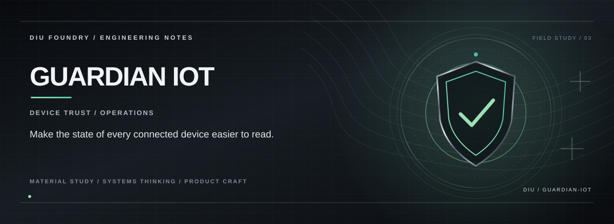

# GUARDIAN IOT

> **DEVICE VISIBILITY / TRUST.**

## THE PREMISE

Guardian IoT is a security-oriented operations interface built around a simple question: can an operator understand what the connected fleet is doing before something becomes an incident?

## THE EXPERIENCE

**Surface state before detail.**  
**Make trust readable.**  
**Design the console for fast decisions.**

## THE SYSTEM

Reusable React components drive device/status views, while routing and charting keep the interface structured for a larger connected-system control plane.

## THE STACK

React 18 · TypeScript · Vite · Tailwind CSS · shadcn/ui · React Router · Recharts · Vitest

## RUN

Requirements: Node.js and npm.

```bash
npm ci
npm run dev
```

Vite prints the development URL. Quality checks:

```bash
npm run build
npm run lint
npm test
```

These commands cover the configured Vite build, ESLint and Vitest scripts.

## PROJECT STATE

**Prototype / active development**

The repository documents the capabilities that are actually implemented; future integrations are intentionally separated from the current product surface.

---

<p align="center"><strong>K. KISHOR KUMAR</strong><br><sub>ENGINEERING / PRODUCT / SYSTEMS</sub></p>
